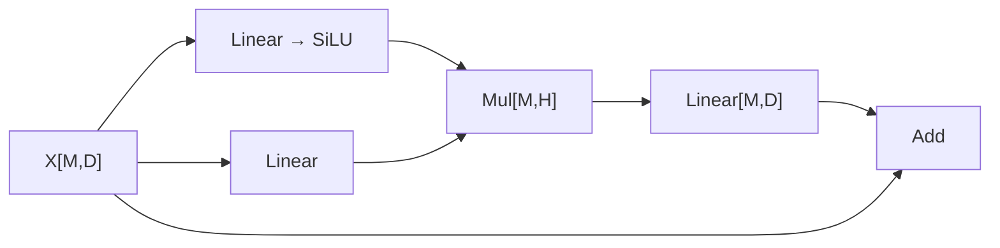

# 静态 FP16 图编译与 SwiGLU FFN

2026-10-13，RK3588 / 厂商 RKNPU 路径。当前实现把 C 描述的 rank-2 FP16 DAG 编译成形状、tile 布局、BO 生命周期和执行计划；权重在编译时驻留并打包，运行时按计划生成和提交寄存器命令。

这不是 ONNX/GGUF 导入器或任意 kernel 编译器。支持节点为 Input、Linear（可选 bias）、Add、Mul、SiLU、erf-GELU、HardSigmoid，以及后续新增的混合 RoPE/self-attention（见 [attention](ATTENTION-KERNELS.md)）、RMSNorm/Softmax（见 [跨 tile 归约](CROSS-TILE-ROW-OPS.md)）。逐元素运算要求相同形状，不自动广播。所有逻辑维度上限为 4096，primitive tile 的 M/K/N 上限仍为 256。

## 首个 LLM 子图

验收表达式为：

```
gate = SiLU(Linear(X, Wgate, optional_bias))
up   = Linear(X, Wup)
Y    = X + Linear(gate * up, Wdown)
```



## 编译及 tiling

1. 从指定输出遍历 DAG，删除不可达节点，拒绝可达循环、无效引用与不支持的节点。
2. 按拓扑顺序推导形状。Linear 的输出通道由节点 `cols` 指定，其余非输入节点不填写形状。
3. 每个张量统一采用 M-major/channel-minor 的 Cube tile 集合。每块使用 `co_tensor_matrix(tile_rows,tile_cols,CO_F16)`；行至少补到12且为4的倍数，通道补到32的倍数。
4. Linear 消费上一层的 channel tile 作为 K tile，分别使用对应预打包权重。K 部分和通过两个设备 BO 乒乓累加；每一步收窄到 FP16。bias 只在最后添加。
5. 记录每个张量的产生位置和最后一次消费位置。仅当旧张量最后消费严格早于新节点时，才复用其 BO slot；因此不会原位覆盖当前操作数。残差 X 保留到最后加法。
6. 在分配前计算驻留 Linear BO、复用 tensor slot、共享 identity 权重和最大 gate scratch 的字节数。默认预算256 MiB，包含 DMA 读取余量和 guard；不包含驱动页对齐、主机上下文和提交时临时 BO。

规划目前采用固定256上限规则及简单的空闲 slot 容量选择，不包含成本模型搜索、跨节点融合或跨核执行。`CO_CHAIN` 每个节点的每个输出 tile 一次 Submit，不是一整张图一次 Submit。较大 SiLU/GELU tile 的 LUT 拆成两段，再接 EW multiply。

本文初始 Linear/逐元素子图的中间张量保持设备 Cube，不上传、下载或 CPU 拼接。Host 仅打包输入、下载输出；后续混合 RMSNorm/Softmax 另有统计下载、系数上传和 Softmax 的 logits CPU 读取，不能把此边界推广到这些节点。guard 检查、输出标记和 cache 同步仍涉及 CPU。输出下载到暂存数组并检查有限值，全部成功后才写入调用方数组；执行失败后可重试。

## API

入口为 [co_graph.h](custom-ops/include/co_graph.h)，通用 Linear 为 [custom_ops.h](custom-ops/include/custom_ops.h)。

```c
co_graph_node nodes[] = {
    {.op=CO_GRAPH_INPUT,  .rows=M, .cols=D},
    {.op=CO_GRAPH_LINEAR, .a=0, .cols=H, .weights=Wgate, .bias=b_gate},
    {.op=CO_GRAPH_LINEAR, .a=0, .cols=H, .weights=Wup},
    {.op=CO_GRAPH_SILU,   .a=1},
    {.op=CO_GRAPH_MUL,    .a=3, .b=2},
    {.op=CO_GRAPH_LINEAR, .a=4, .cols=D, .weights=Wdown},
    {.op=CO_GRAPH_ADD,    .a=5, .b=0},
};
co_graph_desc desc = {nodes, 7, 6, 0};
co_graph_plan plan;
co_graph *graph = NULL;
int rc = co_graph_plan_init(&desc, &plan);  /* 不需要设备或读取权重数据 */
if (!rc) rc = co_graph_compile(fd, &desc, CO_CHAIN, &graph);
/* 编译成功后可释放 nodes、Wgate/Wup/Wdown 和 b_gate。 */
co_graph_input input = {0, x};
if (!rc) rc = co_graph_run(graph, &input, 1, y);
co_graph_destroy(graph);  /* 最后再由调用方关闭 fd */
```

输入按节点 ID 绑定，必须恰好覆盖所有可达 Input；支持多个 Input 和前向节点引用。上下文同步运行，不支持并发调用。参考工具 [graph_cli.c](custom-ops/tools/c/graph_cli.c) 提供实际文件接口和运行时上传/下载计数。

```bash
cmake -S research/custom-ops -B research/custom-ops/build-host
cmake --build research/custom-ops/build-host -j4
ctest --test-dir research/custom-ops/build-host --output-on-failure
bash research/custom-ops/scripts/run-graph-board.sh
```

板端文件接口：

```bash
RKNPU_CORE_MASK=1 ./build/graph_ffn \
  257 257 289 x.bin wg.bin wu.bin wd.bin bias.bin y.bin chain 3
```

输入为小端 row-major FP16；X `[M,D]`、Wgate/Wup `[H,D]`、Wdown `[D,H]`、bias `[H]`、Y `[M,D]`。bias 文件可换为 `-`。

## 验收

[原始记录](custom-ops/results/2026-10-13/graph-20261013-151524/README.md) 保留编译源码哈希、输入输出、完整命令、计数、三个核和 kernel journal 区间。

- Host 14/14及 ASan/UBSan通过。新增测试覆盖分支/残差生命周期、前向引用、多输入绑定、循环/形状拒绝、预算拒绝、分配失败清理、执行失败保留输出和重试。
- 三个核各16组图数值检查、2个非法输入负例；每组重复3次。独立 Python 参考按每个 K tile 的 FP16 收窄建模，并计算 sigmoid 的数学参考。
- 最大绝对误差均为 `0.00048828125`，门限0.003；chain/separate字节一致，重复输出一致。
- 每次运行的上传次数等于输入 tile 数，下载次数等于输出 tile 数。编译期间的权重上传不计入运行计数。
- 原有路径三个核各25个CLI检查和8个设备集合 shape/mode 检查通过；kernel journal 区间无新增消息。

| M / D / H，含 gate bias | Tensor slots | 驻留 BO 请求字节 | 每次 chain Submit | 每次 task | 每次上传/下载 |
|---|---:|---:|---:|---:|---:|
| 1 / 17 / 33 | 4 | 1087936 | 6 | 8 | 1 / 1 |
| 13 / 257 / 289 | 4 | 3395456 | 12 | 22 | 2 / 2 |
| 257 / 257 / 289 | 4 | 10126592 | 24 | 45 | 4 / 4 |
| 513 / 33 / 257 | 4 | 6976640 | 30 | 47 | 3 / 3 |

数值结果仅证明所测形状和值分布。未验证大幅值/长 K FP16 累加的模型精度，也未做 LLM perplexity 或吞吐验收。

## 后续 LLM 范围

当前已实现通用多 tile Linear、静态子图规划和 SwiGLU FFN；后续新增 [跨 tile 混合 RMSNorm/稳定 Softmax](CROSS-TILE-ROW-OPS.md) 及 RMSNorm前置FFN。LayerNorm仍为旧有界混合原语。
后续已加入 [RoPE、固定容量KV cache与self-attention](ATTENTION-KERNELS.md)：静态图用于prefill，独立上下文支持持续decode。Graph attention通过CPU桥接Q/K/V及输出。Cross-attention和优化的decode/FlashAttention尚未实现。维度超过4096的常见 FFN、INT4/INT8路径和 GGUF/ONNX 导入也不在本轮支持范围。
各后续功能有独立验收，不能用本轮 FFN 验收代替。

后续 [完整decoder block](TRANSFORMER-DECODER-BLOCK.md) 新增多输出图入口：Q/K/V共享一个RMSNorm并统一stage/publish；多个output在最后下载前保持存活。
