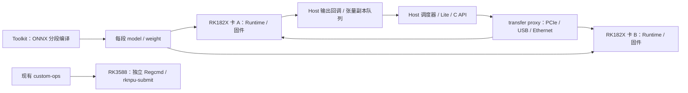

# RKNN3 多卡软件栈静态分析

分析日期：2026-10-10。只读公开头文件、文档、示例及 x86_64 Runtime 的 ELF 元数据和动态符号，没有加载或执行厂商二进制，也没有 RK182X 真机测量。所有源码快照、下载 URL、SHA256 见 [source-manifest.json](../static-analysis/source-manifest.json)，完整路径索引见两个 `*-tree.json`。快照保留上游内容与许可，不将其改标为本项目许可。

2026-10-16 补充：[RK182X 命令生成边界](../../rk182x-re/README.md) 已进一步检查完整 Toolkit、官方板级发行包和 Host 驱动源码，并从官方预转换 `.rknn` 解码出 RV32 NPU 控制程序。该后续报告回答离线编译、Host 传输、设备端参数更新与提交的边界；下文“未反汇编”等限制保留为 10 月 10 日分析范围，不代表后续材料仍不可分析。

固定版本：`airockchip/rknn3-toolkit@2136cc54fa79ad289c43e56ed9cf7e63ef56439b`（2026-08-31，V1.1.0），`airockchip/rknn3-model-zoo@ca92e7fe1a418b220985455446a986b80d6a899f`（2026-09-09）。工具包与 model-zoo 是两个独立 revision，不能默认版本兼容；部署须回读 API/driver 版本及固件版本。

## 软件层与设备边界

官方 [README_CN](../static-analysis/sources/rknn3-toolkit/README_CN.md) 5–37 行列出 Toolkit、Toolkit Lite、C Runtime、服务端、固件，支持 RK1820/RK1828/RK3572。RK182X 是协处理器：主控可以是 RK3588/RK3576/PC，借助 `rknn3_transfer_proxy` 经 PCIe/USB/Ethernet 通信。RK3588 在该架构中作为主控，不代表 RK3588 自身 NPU 支持 RKNN3 命令。

tree 清单能看到 `librknn3_api`、`librknn3_api_native`、`librknn3_api_rkcp`、`rknn3-server` 和 proxy 的不同平台产物。文件名只证明组件存在；未反汇编这些库，不能据此确定路由协议、DMA 描述符、驱动 ioctl 或内部队列实现。`rkllm3-server` 是 LLM API 服务，与 NPU 提交服务及 proxy 不同。

## API 与适配层对应

证据为 [rknn3_api.h](../static-analysis/sources/rknn3-toolkit/rknn3-runtime/rknn3-api/include/rknn3_api.h)，下面行号均对应该固定快照。

| 调度需求 | 已公开接口或字段 | 对新模块的约束 |
|---|---|---|
| 设备身份 | `rknn3_find_devices`（1489）、`rknn3_device.id/type/mem_info`（681–698）、`rknn3_init_extend.device_id`（635–640） | 每卡独立 context；不能以 core_id 代替卡 ID |
| SDK 身份 | `RKNN3_QUERY_SDK_VERSION`（90）、`api_version/drv_version`（399–403） | 数据集按驱动/SDK/固件版本分域 |
| 模型加载 | `rknn3_init`、`rknn3_load_model_from_path`（1203）、`rknn3_model_init` | 模型/权重准备独立计费；不能把冷启动成本混入驻留服务 |
| 内存预算 | `RKNN3_QUERY_CORE_MEM_SIZE`（92）、`RKNN3_QUERY_DEVICE_MEM_INFO`（98）、`RKNN3_QUERY_ALLOCATION_INFO`（102）；`sys_total/sys_free/node_mem_info`（664–670） | 设备系统总量、各 node 可用量和模型 weight/internal 分开记录；查询快照不能保证未来分配成功 |
| 张量容量 | `aligned_size`、shape/stride/layout/dtype、`core_id`；`rknn3_tensor_mem`（426–438） | 容量用真实对齐后大小；Host 虚拟地址与 device buffer_id/phys_addr/fd 不互换 |
| 传输 | `rknn3_create_mem`（1383）、`rknn3_mem_sync`（1409）、`rknn3_mem_sync_range`（1421） | 同步可能包含数据传输；FROM_DEVICE 注释允许按块传输，默认 2 MiB，不能按 RK3588 cache sync 解释 |
| 执行 | `rknn3_run`（1356）、`rknn3_session_run`（1686）、`rknn3_session_run_async`（1703） | 普通 run 与 LLM session 两种 payload；同步返回完成与异步回调完成分别绑定 token |
| 异步完成 | result/output callback、`rknn3_session_query_state`（1644）、session stop/pause/resume | 该公开头文件未提供通用 `rknn3_wait`；统一 wait 需适配层追踪最终状态，不能将 async 返回当完成 |
| KV 状态 | `set_kvcache_mem/group`、session KV 导入/导出/清理 | 迁移 session 必须考虑 KV、位置、采样状态和目标模型，非只复制激活 |
| 权重内存注入 | `rknn3_set_weight_mem` 注释（1464）“Current version only supports RK3572” | 不把这个 API 的存在登记为 RK182X 可用 |

`rknn3_create_mem_from_fd` 的存在没有证明跨卡 fd 共享，更没有证明 RK3588 BO 可直接导入 RK182X。公开 API 未见卡间 P2P copy/跨 context buffer 导入保证；本轮只建立 Host staging 的建模边界。没有任何 Regcmd 布局、task 描述符或 IRQ 编码兼容性的证据。

## 多卡示例的实际执行路径

[model-zoo 多卡文档](../static-analysis/sources/rknn3-model-zoo/examples/multicard/README.md) 描述按连续 Transformer layer 分段，将末段 norm/lm_head 纳入估算权重预算，按量化权重体积选切分点。它属于模型切分，未按实测服务时间、链路或排队时间优化切分。

[main.cc](../static-analysis/sources/rknn3-model-zoo/examples/multicard/cpp/main.cc) 有以下可核对事实：

1. 2050–2099：发现卡，自动选择前 N 张或使用外部指定 ID；1574–1686：每段 init/load/model_init/session_init/set_callback，固定绑定卡与 core mask。
2. 1176–1231：`stage_output_callback` 为输出复制 `attr.aligned_size` 字节，`memcpy` 到 `TensorBlob::data`，再放入相邻 stage 的队列。复制保住回调输出生命周期，同时增加 Host 缓冲占用。
3. 1689–1790：下游 worker 以条件变量等待，FIFO pop；从 Host blob 得到 FP16 embedding 指针，调用自己的 `rknn3_session_run`。下一跳传入有效 token 字节，不一定等于上一步复制的全部 aligned bytes。
4. 1792–1864：为后续 stage 启动 worker；首段 session_run，关闭首段生产队列并 join。prefill 的桶可以流水重叠，但单次 decode 下一 token 仍依赖末段采样。多卡不自动意味着单 token 延迟下降。
5. `StageSlot::batches` 使用 deque；没有看到有界队列容量或生产端内存门禁。卡上内存预算之外，模拟器应额外预算 Host 侧排队张量；本模块的设备预算不能当作整个官方服务的 RSS 预测。
6. 每段性能采用 `gettimeofday` 包围 session_run（1768–1775），是调用墙钟时间，不是 NPU commit→IRQ 服务。官方文档性能与本项目 RK3588 service 字段不能直接合并。

[Python 示例](../static-analysis/sources/rknn3-toolkit/rknn3-toolkit-lite/examples/multicard/rknn_multicard_qwen35_test.py) 457–521 行对应同一机制：`ctypes.string_at` 复制输出，条件变量队列，worker 消费。它为独立实现佐证，未证明 Runtime 内部通信一定执行了哪些 DMA 或 copy。

## 驻留与迁移成本模型

同一 context 重复执行时，模型/权重可保持已加载；RK3588 现有框架持有的是设备可访问 DDR BO，而不是跨 Job 隐式 CBUF 内容。缓存命中必须绑定设备 ID、模型哈希、布局、精度、版本及状态代次。静态信息不足以给 RK182X 命中率或服务时间赋值。

对跨卡输出，保守 Host staging 串行模型为：

`T_migration = T_download + T_host_copy + T_layout + T_upload + T_setup`。

每段链路 `T_link(B) = latency_ns + ceil(B * 1e9 / bandwidth_bytes_per_s)`，另计链路队列占用。该公式是可配置的场景模型，不是已测 PCIe/USB 有效带宽。无布局变化时才能令 `T_layout=0`；mem_sync 的 chunk 行为、Host 队列 aligned bytes 与有效上传 bytes 必须分别记录。并行传输只能在明确链路/Host 资源允许重叠时开启。

调度总完成时间需包含依赖释放、设备队列、迁移和服务，不重复累加已经包含这些阶段的 Runtime wall time。服务使用本轮 RK3588 条件匹配数据；RK182X 的 duration 必须另测或在示例中明确标为假设。迁移收益门槛为目标完成预测早于留在源卡，且源/目标暂存内存都满足预算；不可直接使用“estimated DDR bytes / PCIe bandwidth”替代迁移实测。

## 当前结论与后续硬件校准

公开 V1.1.0 已提供 RK182X 多卡级联示例、设备发现、独立模型 context、内存查询和 Host/device 同步接口。本项目交付独立 RK182X 适配边界；公开源码无法证明内部调度公平性、P2P、可抢占的底层 task 或 RK3588 命令复用。

后续接入硬件时，分别测量 model load、驻留 run、mem_sync 两方向、range/chunk 大小、并发链路争用、Host copy/layout 和 KV import/export。每项记录卡序列 ID、固件/Runtime/驱动版本、连接拓扑、原始事件、对齐字节、独立 block 与置信区间，才能把当前配置参数提升为测量模型。

## Runtime ELF 静态交叉核对

同一固定 toolkit revision 的 `rknn3-runtime/rknn3-api/Linux/x86_64/librknn3_api.so`，大小 1635376 字节，SHA256 `dc14b0c978fc06d9f00ca04dbfa90bd326362e264020c1f06ff136472c0c3362`。下载 URL、准确命令及每份完整文本报告的哈希见 [binary-manifest.json](../static-analysis/binary-manifest.json)。分析仅运行系统 `readelf`/`nm` 读取文件，未使用 `ldd`、dlopen 或执行库代码；二进制缓存在仓库外，报告随模块保留。

[ELF 动态表](../static-analysis/elf-dynamic.txt) 显示 SONAME 为 `librknn3_api_rkcp.so`，虽下载文件名为 `librknn3_api.so`。该产物是 ELF64 little-endian x86-64；NEEDED 为 pthread、stdc++、m、gcc_s、c。这直接确认所审查的 PC 产物标识为 rkcp 运行库，不能将此结论推到未检查的 aarch64/native 产物。

[完整导出符号](../static-analysis/elf-exported-symbols.txt) 中有公开 `rknn3_find_devices/query/create_mem/mem_sync/mem_sync_range/run/session_run/session_run_async/session_query_state`，与固定头文件对应。还可见 C++ `RK::TransferClient::{findDevices,open,send,recv,close}`、`RK::TransferBuffer::{alloc,create,dup,map,unmap,getAlignedSize}` 和以 `RK::MsgHeader*` 为参数的各类 session 回调。结合[导入符号](../static-analysis/elf-imported-symbols.txt)中的 `socket/socketpair/connect/sendmsg/mmap`，能确认库具有消息/缓冲通信组件；仅凭符号不能确定每次调用选择哪种物理链路、是否使用 fd 传递或具体复制次数。

内部 C++ 导出 `rknn3_session_wait(void*, std::shared_ptr<RK::TransferBuffer>)` 和 `rknn3_session_wait_pingpong` 不在公开 C API 契约中，不能将其作为稳定统一 wait 入口。公开异步绑定应使用 callback / query_state 并核验终态。符号中未发现稳定的公开 `rknn3_wait` 或卡间 P2P copy 接口；这是所检查版本的静态表范围，未据此宣称固件不具备任何相关机制。
