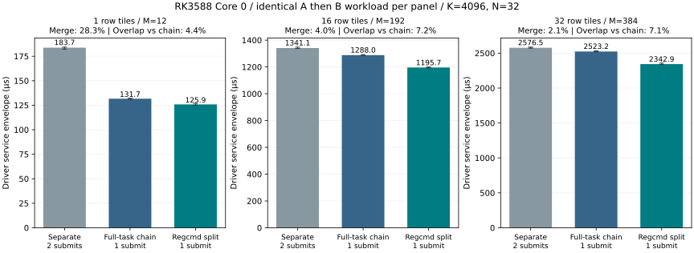

# RK3588 同核 MatMul / DPU-only 重叠实验

2026-10-14 至 2026-10-15，Orange Pi 5 Plus / RK3588 / FP16 / 厂商 rknpu 0.9.8，
内核 `6.1.43-rockchip-rk3588-rknpu098`，Core 0，读取 NPU 频率 1 GHz。
后续配对采集固定 CPU 4、关闭 PC task 提前取指；未修改时钟或电源设置。

## 结论与适用范围

**完整 MatMul / DPU-only task 直接串成一条链，只观察到提交包络摊销；
重新划分 regcmd/task 后，找到了正确且有可重复部分重叠收益的同核编排。**
最新三组对照中，32 tile 的普通两次 Submit 为 2.577 ms，完整 task 单链为 2.523 ms，
regcmd 重划分为 2.343 ms：合并 Submit 节省 2.07%，重划分相对完整链额外节省 7.14%，
相对普通串行总节省 9.06%。这些比例有不同分母，不能直接相加。

实验中 A 是完整 MatMul，输出仍经过自己的 DPU；B 是独立输入的 DPU-only HardSigmoid LUT。
多 tile 对应大 MatMul 的行切片，同一配置使用相同 X/W/B 和独立输出 BO。
B 不能直接依赖当前 A 尚未产生的结果；真实流水需使用前序 tile 或另行处理依赖。

这里验证的是自写探针中的模块编排，尚未自动接入 `co_graph` 或完整 attention。
现有稳定 Softmax 还涉及 CPU 和矩阵路径，不能把 LUT 代理的收益当作 attention 端到端加速。
没有获得模块时间线、纯 CNA/CORE/DPU 周期或 FIFO 占用；不能声称任意任务可独立并发或 DPU 已全部隐藏。

## 主基线：三组应怎样比较

| 组 | 记录名 | 执行顺序 | Submit / IRQ |
|---|---|---|---:|
| 普通串行 | `separate` | 完成全部完整 A task，再执行全部完整 B task，各一次 blocking Submit | 2 / 2 |
| 同核完整 task 链 | `a_then_b` | `[A0,A1,…,B0,B1,…]`，task 保持完整，单链顺序执行 | 1 / 1 |
| regcmd 重划分 | `overlap` | 每 tile 先启动 `CNA/CORE(Ai)+DPU(Bi)`，再接 `DPU(Ai)` | 1 / 1 |

这一定义按自然 A→B 流程构建，并不表示复刻了 RKNN Runtime 的默认内部调度。
三组采用相同 tiling、精度和 LUT 缓存策略，分别量化“合并 Submit”和“模块重叠”的作用。

**历史字段 `serial` 是人为构造的同布局机制对照，不是默认串行流程。**
它先写入 CNA/CORE(A)+DPU(B) 配置但只启动 B，第二个 task 才启动完整 A。
该对照与 overlap 每 tile 只差两个启动位图，适合检查启动时机；主收益应与上表的完整 A→B 路径比较。

另外保留 `ab=[A0,B0,A1,B1,…]`、反向 `ba=[B0,A0,B1,A1,…]`，以及 A、B、BB 成本臂。
最新采集共九臂；`ab` 检查逐 tile 交错顺序，`BB` 含两倍数量的 B task。

## 可工作的 regcmd/task 划分

最初成功组合为 `M=N=K=256` 的 FP16 MatMul 与 61440 个 FP16 LUT 元素。
完整原语分别为 126 和 1070 个命令字；重新划分为：

```text
一个 blocking Submit，task_number=2，PC task ping-pong=0

Task 0（1124 words）：
    CNA/CORE 配置来自 A
    DPU/DPU_RDMA 配置来自 B（flying，读取 B 的独立输入）
    标准链尾，OP_ENABLE=0x1d
    → 启动矩阵路径 A 与 DPU-only B

Task 1（74 words）：
    DPU/DPU_RDMA 配置来自 A
    标准终端链尾，OP_ENABLE=0x18
    → 接收 MatMul 的结果，转换并写出
```

A 和 B 共享一个 DPU，DPU(B) 与 DPU(A) 顺序使用；不是让两个 DPU 操作同时运行。
CNA/CORE 指针仍由驱动设置，DPU/DPU_RDMA 使用原有 `S_POINTER=0xe`。
`rkt_chain_pack_at` 按每段实际长度编码地址/长度，`rkt_chain_verify` 检查完整链；
不是仅把两段命令拼进一个描述符，也没有破坏 A 的输出或完成通路。

后续扩到 1/4/16/32 tile，最多 64 个 PC task。
LUT 缓存开启时，每个含 B 的 Submit 都装载首份完整表，后续 B 仍完整配置几何；
移除 MatMul 未使用的 LUT 访问端口写，不依赖前一个 job 的表状态。
三组都应用同样的缓存策略，没有使用 CBUF weight reuse。
生产 `co_emit_mm` 的范围未放宽；实验 wide-K 由探针直接调用底层生成器并检查打包和 BO 边界。

## 最新三组实测

证据：[matched-overlap-20261015-152224](../custom-ops/results/2026-10-15/matched-overlap-20261015-152224)，
[analysis.json](../custom-ops/results/2026-10-15/matched-overlap-20261015-152224/analysis.json)。
6 个配置，各 12 轮 warmup、128 轮配对采样，共 7560 个九臂测量记录、**8400 次真实 Submit，全部验收通过**。
采集前后普通 AB 基线通过；内核只有初始受控诊断的一次超时/soft reset，正式样本没有超时或 IOMMU fault。

下表每个 MatMul tile 均为 `12×4096×32`，每 tile B 为 32768 个 FP16 元素。
时间为驱动服务包络中位数，单位 µs；百分比先逐轮配对再取中位。

| tile 数 | 普通串行 | 完整 task 链 | regcmd 重划分 | 合并 Submit 节省 | 重划分相对完整链额外节省 | 相对普通串行总节省 |
|---:|---:|---:|---:|---:|---:|---:|
| 1 | 183.746 | 131.685 | 125.853 | 28.33% | 4.43% | 31.40% |
| 16 | 1341.063 | 1287.982 | 1195.670 | 3.96% | **7.16%** | 10.85% |
| 32 | 2576.546 | 2523.171 | 2342.923 | 2.07% | **7.14%** | 9.06% |



每个子图比较相同工作量，不同子图的总工作量不同。
32 tile 对应 `A[384,4096] × W[32,4096]^T` 与 1048576 个独立 LUT 元素。
该组增量 overlap 节省的 p10/p90 为 **6.60% / 7.55%**。
完整提交函数耗时之和的三组中位数为 **2865.875 / 2764.376 / 2578.733 µs**，收益没有被提交打包路径完全抵消。

顺序交叉检查中，32 tile 的逐对 AB 链为 2524.483 µs，旧机制 `serial` 为 2522.880 µs，
接近主基线 `a_then_b` 的 2523.171 µs；overlap 相对三者分别节省 **7.22% / 7.17% / 7.14%**。
这支持约 7% 的额外收益，但不能把机制对照重新称为默认流程。

### 为什么 tile 增加后总提升比例下降

单 tile 合并 Submit 省约 52 µs，32 tile 仍只省约 53 µs；这一项不会随 tile 数线性增加。
模块重叠的额外节省则从约 6 µs 增至约 180 µs，平均每 tile 约 5–6 µs。
所以单 tile 的 31.4% 主要来自提交摊销；32 tile 的绝对总节省更大，但固定开销占比更低。

近似模型为 `T_sep≈2H+n(a+b)`、`T_chain≈H+n(a+b)`、`T_overlap≈H+n(a+b-o)`。
其中 H 是未进一步分解的服务包络，o 是每 tile 的有效隐藏时间，不能直接当作某个模块周期。

## 工作量匹配、隐藏比例与 tiling

三个指标分开报告：

```text
合并收益 = (T_separate - T_a_then_b) / T_separate
额外 overlap 收益 = (T_a_then_b - T_overlap) / T_a_then_b
总收益 = (T_separate - T_overlap) / T_separate

DPU 链内预算 ≈ T_BB - T_B
隐藏比例估计 = (T_baseline - T_overlap) / (T_BB - T_B)
```

隐藏比例必须注明 baseline；历史 `hidden_dpu_budget_pct` 使用旧机制 `serial`，
新结果另列相对 `ab`、`a_then_b` 的估计。预算包括取指、配置、DMA 和 task 推进，不是纯 DPU 周期。

初筛的 168 个 M/N/K/B 组合中，152 个通过、16 个失败；随后测试批量 tile、LUT 单次装载和更早启动。
两轮六臂正式采集各 8400 次 Submit 全部通过，独立复现了约 7% 的机制收益。
其中相同 `12/4096/32`、16 tile 的一轮结果为：

| 每 tile B 元素 | 机制对照 → overlap | 整体节省 | DPU 隐藏估计 |
|---:|---:|---:|---:|
| 32768 | 1287.107 → 1190.858 µs | 7.46% | 24.4% |
| 8192 | 995.736 → 958.404 µs | 3.74% | 33.4% |

将数据量缩到四分之一，并没有得到接近全部隐藏。32 tile、B=3840 的另一组隐藏估计约 46.6%，整体只节省约 3.1%。
不能把“原任务隐藏了四分之一耗时”解释为固定不变的空窗，或认为四分之一数据量就会 free。
DPU 时间近似含固定启动/配置成本与随数据量变化的处理成本；更换任务也可能改变 DMA 和流水推进时序。

### 完整 CNA/CORE 时间不等于可隐藏窗口

只有在“CNA/CORE 全部完成后 DPU(A) 才开始”的理想分阶段模型里，
`T_serial=C+B+D`、`T_overlap=max(C,B)+D`，B≤C 才可直接视为完全隐藏。
实际 MatMul 是流式输出：DPU(A) 可以消费首批结果，不必等全部矩阵计算结束。
B 占住 DPU 可能使中间缓冲积压并触发 CORE 背压。
有效窗口取决于启动阶段、数据流、缓冲和切换成本，不能用完整 CNA/CORE 忙碌时间代替。
本轮没有直接测出该窗口；尚未验收出 DPU-only 几乎 free 的方案。

### 固定总工作量下，最高 overlap 比例未必最快

固定 `A[384,512] × W[32,512]^T` 与 122880 个 LUT 元素，在相同全局输入上只改变分片：

| tile M / tile 数 | 完整 A→B 单链 | overlap |
|---|---:|---:|
| 192 / 2 | 302.746 µs | 282.329 µs |
| 96 / 4 | **279.413 µs** | 279.996 µs |

192 行方案的 overlap 比例更高，仍慢于 96 行方案的完整串行链。
优化目标应是最小化整条调度时间；前述约 7% 限定于所列几何与划分，不代表优于任意最佳串行 tiling。

## 早期完整 task 实验与失败边界

2026-10-14 的粗粒度实验使用 256³ MatMul A 和 240×256 LUT B。
两个 task 完整保留，独立输出；两轮各 64 reps×8 Submit，数值/guard 均通过：

| 轮次 | A | B | 完整 AB 链 | 完整 BA 链 | 两次串行 S1 |
|---|---:|---:|---:|---:|---:|
| core0-a | 334.829 µs | 102.665 µs | 384.849 µs | 384.412 µs | 436.911 µs |
| core0-b | 422.766 µs | 101.499 µs | 472.786 µs | 472.056 µs | 523.826 µs |

AB 链与同质 BB 链相比，额外节省分别只有 +146 / −146 ns；当时只观察到约 52 µs 的固定包络摊销。
两轮 A 的绝对时间不同，结论仅来自各轮内部配对。单次末尾 IRQ 本身不能证明链内部完全串行。
**这个负结果只适用于完整 task 编排，不能推广为硬件或厂商通路无法实现模块级重叠。**

| 尝试 | 观测与边界 |
|---|---|
| A 的 `0x1d→0x15` 去 DPU 位 | 单 A、A→B、B→A 均超时；B→A 中 B 可正确写出。破坏了 A 输出/完成通路，不能据此证明物理不支持 overlap |
| 直接写模块 OP_EN | 单独 MatMul 和 LUT 能正确运行；不等于任意组合流都成立 |
| 单描述符直接拼流或显式 DPU 两组指针 | 可出现 Submit 成功但第二输出缺失/部分写；等待 20 ms 仍错误，未验收成功 |
| 只把硬件 task 数改为 2 | 单段流超时，DPU 启动次数不能代替真实 PC task 分段和链尾 |
| PC task ping-pong=1 | 有通过轮次，也出现完整 AB/BA 的 LUT 静默错误；推荐配置固定关闭 |
| CNA/CORE 直接提前到 LUT 取指前启动 | 短测约 10%–11% 的候选在 128 轮失败，淘汰，不用作正式收益 |
| K=8192/12288/14336 | 独立 MatMul A 基线已超时，全部拒绝；不能用来推断 overlap 上限或扩大生产支持范围 |

失败可能影响后续状态；采集器保留失败记录，通过已知诊断超时复位后核验普通 AB，再进入下一配置。
正式配置要求所有 case 通过，且内核仅允许初始诊断的一次 soft reset。

## 可观测性：现在测到的是哪一层

| 量 | 当前证据 | 限制 |
|---|---|---|
| 驱动服务包络 | `hw_elapse_time` | 每次 Submit 的配置、执行及 IRQ 延迟，非纯硬件周期 |
| ioctl / 提交函数耗时 | Host 单调时钟 | 含等待及相应 Host 开销，不含 CPU 数值评分 |
| 完成位、任务数 | 末 task `int_status`、实际描述符 | 确认完成与链结构，没有链内逐 task 时间戳 |
| 完成中断 | `/proc/interrupts` | 两次 Submit 为 2 次、单链为 1 次，不是模块时间线 |

CNA/CORE/DPU 的 `S_STATUS` 和模块完成位可作为后续内核带时间戳采样的候选，
但本轮未实施或验证该采样；idle/operating/waiting 区间也不等于纯计算时间。
RK3588 没有在本实验中可用的分模块执行周期接口。
已知 amount 计数器候选在 RK3588 的配置中禁用，`0x2000` 页读取有历史挂死记录，
不应当作可直接补读的模块计时器，见 [DMA 计数器调查](../../perf/hw-byte-counters.md)。
同核新增线程或异步 Submit 仍受驱动每核单活动 job 调度约束；相关完整 task/job 实验见
[GEMM/GEMV 并发](GEMM-GEMV-CONCURRENCY.md)，不能与本轮模块重划分混为一谈。

## 证据索引

所有 raw 结果都在本地 `custom-ops/results/`，按仓库既有规则不进入 Git。
每个目录保存实际配置、源码哈希、JSONL、命令流、退出码及内核日志；只在同一采集中做配对比较。

| 阶段 | 本地结果目录 | 用途 |
|---|---|---|
| 粗粒度完整 task | [2026-10-14/overlap-20261014-145427](../custom-ops/results/2026-10-14/overlap-20261014-145427) | 早期完整 AB/BA、同质链和位图消融 |
| 首次模块拆分 | [regcmd-overlap-20261015-140139](../custom-ops/results/2026-10-15/regcmd-overlap-20261015-140139) / [140422](../custom-ops/results/2026-10-15/regcmd-overlap-20261015-140422) | 128 轮节省 9.771 / 8.750 µs；短 B [140247](../custom-ops/results/2026-10-15/regcmd-overlap-20261015-140247) 收益未分辨 |
| 168 组合初筛 | [matched-overlap-20261015-143244](../custom-ops/results/2026-10-15/matched-overlap-20261015-143244) | 152 通过、16 失败，配置均在该目录 config.json |
| tile / 表缓存 / 提前启动 | [143611](../custom-ops/results/2026-10-15/matched-overlap-20261015-143611) / [143934](../custom-ops/results/2026-10-15/matched-overlap-20261015-143934) / [144305](../custom-ops/results/2026-10-15/matched-overlap-20261015-144305) | 扫描结果与失败候选，不代替正式验收 |
| 128 轮候选复验 | [144546](../custom-ops/results/2026-10-15/matched-overlap-20261015-144546) | 淘汰更早启动候选 |
| 超长 K 探索 | [144941](../custom-ops/results/2026-10-15/matched-overlap-20261015-144941) | K≥8192 的独立 A 基线失败 |
| 六臂正式复验 | [145230](../custom-ops/results/2026-10-15/matched-overlap-20261015-145230) / [145600](../custom-ops/results/2026-10-15/matched-overlap-20261015-145600) | 各 8400 次 Submit；后一轮相同全局输入与固定总量 tiling 对照 |
| 正向 AB / 全 A→全 B | [151841](../custom-ops/results/2026-10-15/matched-overlap-20261015-151841) | 八臂，尚不含两次 Submit 基线 |
| 最新三组统一比较 | [152224](../custom-ops/results/2026-10-15/matched-overlap-20261015-152224) | 九臂、7560 记录、8400 次真实 Submit |

早期分散文档、入口和试探配置的工作树副本已清理；原文件压缩归档于
[overlap-consolidation-20261015-180910](../custom-ops/results/2026-10-15/overlap-consolidation-20261015-180910)，附 SHA256 清单。
保留此前采集的实际配置和源哈希，不把历史采集回写为最新九臂实验。

## 复跑与核验

从仓库根目录运行。依赖恢复见 [上游组件](../upstream-components/README.md)，板端连接读取未跟踪的 `.env`。

```bash
# 唯一推荐入口：三组主基线、其余六臂诊断、6 配置、128 轮
bash research/custom-ops/scripts/run-matched-overlap-board.sh \
  research/custom-ops/tools/python/matched_overlap_configs/three-arm-baseline.json

# 离线核验最新九臂，以及历史六/八臂 matched 记录
python3 research/custom-ops/tools/python/matched_overlap_analyze.py RESULTS

# 可选绘图，需要 matplotlib；默认只生成 SVG，--format png 可导出位图
python3 research/custom-ops/tools/python/matched_overlap_plot.py RESULTS OUTPUT_PREFIX

# 无设备构建与验证
cmake -S research/custom-ops -B build-regcmd-overlap -DCMAKE_BUILD_TYPE=Release
cmake --build build-regcmd-overlap -j4
ctest --test-dir build-regcmd-overlap --output-on-failure
```

Board 脚本每次上传实际源码、在新目录编译，不覆盖已有结果。原始粗粒度复核器
`tools/python/overlap_verify.py` 及原脚本仍由 GEMM/GEMV 实验使用，保持其独立入口。
历史探索可从各结果目录的 `config.json` 恢复，不另保留重复的临时配置集合。

当前维护代码为 [探针](../custom-ops/tools/c/regcmd_overlap_probe.c)、
[采集器](../custom-ops/tools/python/matched_overlap_campaign.py)、
[核验器](../custom-ops/tools/python/matched_overlap_analyze.py)、
[负例测试](../custom-ops/tests/python/matched_overlap_analyze_test.py)。
实际任务/链结构、输入输出边界、两次 Submit 求和、缺失完成事件及错误 IRQ 都有检查；
正式数据采集时的 21 项 CTest 与清理后的 20 项 CTest 均通过；当前核验器还对历史六/八/九臂的 22 个配置只读复核通过。
数值结果不因文档合并重新宣称采集。
