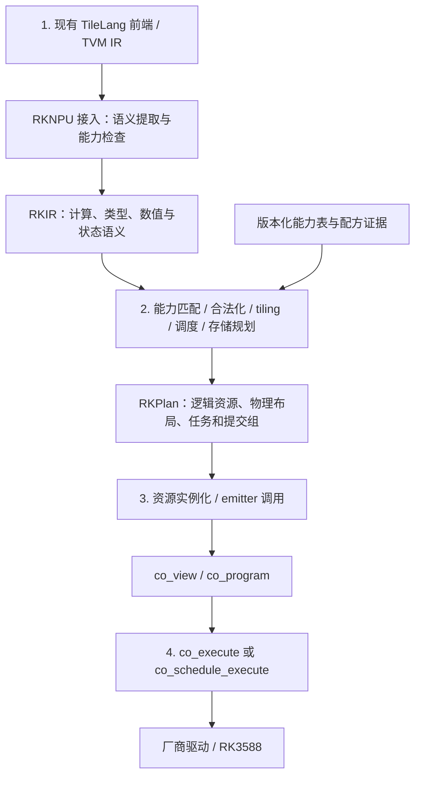

# TileLang 的 RKNPU IR 与专用后端：顶层设计

日期：2026-10-20。状态：目标架构；已有部分 TileLang/RKPlan 主机原型，尚未达到本文目标。实际进度与阻断项见 [复核报告](REVIEW-2026-10-20.md)。配套：[Coding Agent 开发细则](specific.md)。下文的能力范围是设计目标，不能替代实施验收。

范围修订：2026-10-23。项目复用 TileLang 语言、前端及其 TVM IR，新增面向 RKNPU 的语义接入、RKIR、lowering、计划与运行后端。工作重点是 NPU IR 与后端；不从零开发替代 TileLang 的语言前端。2026-10-20 的复核报告和文末版本号为历史快照，当前进度以 `IMPLEMENTATION-STATUS.md` 及实际代码、日志为准。

## 1. 审查结论与目标

四层架构和 RKIR / RKPlan 分离是合理的。RKNPU 是由固定功能单元、DMA、寄存器配置与 task 组成的执行目标；后端的核心工作是把可识别的计算映射到已验证配方，而不是生成通用线程指令。RKIR 保留语义、RKPlan 固化合法执行计划、实例化阶段绑定设备资源，这个分界应当保留。

建议对原设想作以下修订。

| 原设想 | 审查与修订 |
|---|---|
| TileLang 接入 NPU | 复用现有前端与 PrimFunc/TileOp，在 GPU 特定 lowering 之前接入 RKNPU 后端；定义后端可接受的语义子集，不另造语言、解析器或通用前端。仅更换最终 codegen 不足以保留 GEMM、循环和布局语义 |
| RKIR 记录 shape、dtype、输入输出和静态参数 | 增加累加/舍入语义、近似许可、值域、逻辑索引、状态版本与副作用；否则 FP32 accumulator 很容易被错误变成 FP16 分片累加 |
| RKPlan 描述任务、缓冲与依赖 | 增加物理布局版本、padding 有效性、Host 数据准备、同步点、提交配方、资源上限、设备配置和证据版本；不能只建 NPU task DAG |
| 第二层从零开发 | 当前已有 `co_graph_plan_init`、`co_linear_plan_init_ex` 和图生命周期规划，应提取复用其纯分析逻辑。现有 `co_graph_compile` 会分配设备资源，不能直接充当无设备的编译接口 |
| 同形状 EW + 广播处理 | 第一版拒绝任意广播；常量/运行时 Host 标量可通过明确的 Host 展开规则接入。设备 Tensor 广播需要独立实现，不以原生标量探针替代通用能力 |
| LUT 激活检查值域 | 编译期证明、运行时可执行检查、用户显式前置条件必须区分。发射器没有自动扫描 Tensor 值域，不能把一个注解当作已经检查 |
| 第三层决定提交分组 | 第二层决定合法分组和允许的降级方案，第三层校验并实例化。第三层不能临时猜测新的融合或调度 |
| 复用 `co_execute` | 保留。可复用其 workspace/profiled 入口；显式选核走已有 `co_schedule_execute` 适配器。不要重复实现链封口、句柄列表和同步 |
| 借鉴高性能参考实现 | 借鉴 plan/workspace/packed-weight 分离和成本方法；新的寄存器配方、数据布局、多核及 split-K 必须独立接入、验收 |

首个交付目标是：一个可离线编译、可解释拒绝原因的静态 FP16 rank-2 后端，覆盖 MatMul、同形状 Add/Mul、受限激活及其组合；从 TileLang 输入到 RKIR、RKPlan、custom-ops 真机执行形成闭环。此目标不等于支持任意 TileLang kernel、完整训练或纯 NPU Transformer。

## 2. 四层职责与接口

| 层 | 输入 / 输出 | 核心不变量 |
|---|---|---|
| TileLang/TVM 接入适配 | 现有 PrimFunc/TileOp → RKIR | 复用上游 IR 与分析；不支持的语义在丢失源位置前拒绝；不忽略有语义作用的同步、线程通信和精度 |
| 编译后端 | RKIR + TargetProfile → RKPlan | 不打开设备、不分配 BO、不读取 IOVA；每个任务均有可验证的 lowering 依据 |
| 任务代码生成与实例化 | RKPlan + 常量 + runtime bindings → workspace/program | 逻辑 buffer 映射到有效 `co_view`；所有 emitter 前置条件再次检查 |
| 执行 | programs + submit groups → 结果 / 失败 | 遵守同一地址域、同步、生存期和核绑定契约；完成后才发布结果 |

编译期可以读取显式提供的 Host 常量来折叠/离线打包，但默认纯规划只使用常量描述和内容哈希，不要求访问设备或运行时 Tensor。运行时参数分为固定形状的 Tensor 内容、标量值、状态句柄；动态 shape 在第一版不支持。未来动态 shape 应按实际形状特化并重新验证，不能仅替换计划中的尺寸数字。

## 3. TileLang 接入边界

上游源码提供后端上下文、独立 lowering pipeline 及 codegen 入口。设计上应在仍保留 tile 级计算的位置建立 RKNPU 分支，而非先运行 CUDA/HIP 的线程、共享存储及矩阵指令 lowering，再从低层代码猜算子。当前上游接口会变化，实施前锁定 TileLang 与其 TVM 依赖的 commit。[官方 lower 源码](https://github.com/tile-ai/tilelang/blob/main/tilelang/engine/lower.py)、[官方 PassPipeline](https://github.com/tile-ai/tilelang/blob/main/tilelang/backend/pass_pipeline/pipeline.py)。

第一阶段提供独立 `compile_tilelang(PrimFunc, *, profile, options)` 后端入口（接口见 specific §12.1），再接入 TileLang backend/JIT adapter；这是本项目接口，不是上游已有 API。产物是 RKPlan 与可调用执行适配器，不强求把 JSON 伪装成 GPU kernel source。

适配器是后端入口的一部分。优先使用锁定版本已有的 IR visitor、算术化简、buffer 访问与依赖分析、规范化 pass；缺少的目标专用分析才在本仓库补充。不解析 Python 源码或 IR 打印文本，不复制 TileLang 的类型系统、解析与通用调度体系。提取以算子、访问区域和数据依赖为单位，不以“整个函数恰有三个参数、一个 GEMM、固定次数 copy”或变量名称定义支持范围。早期原型的固定外形限制须列为接入缺口，不能上升为硬件限制。

允许的起始输入模式为：静态 Tensor、可证明边界的 tile copy、可识别 GEMM、同形状逐元素表达式、静态循环和显式输出。必须区分：

- **计算语义**：索引、归约顺序要求、accumulator dtype、mask、初值及循环携带值，必须保存。
- **可重排的调度提示**：只有证明不影响语义时，才能重新选择 tile 和执行顺序，并在编译报告中列出被替换的提示。
- **GPU 特定执行约束**：warp/thread 通信、原子操作、异步 copy/barrier 等，第一版直接拒绝，不能静默丢弃。

第一版优先识别规范化 GEMM 和明确的组合节点，不实现任意标量循环的算子自动发现。运行时权重可从 Host 重打包；若上游产生设备动态权重，而其 feature 布局无法直接用作 weight 布局，则必须有显式桥接节点或拒绝。

已支持的 primitive 应按静态数据流组合，分支、残差和多输出由 RKIR 与后端规划表达。SwiGLU 是检验组合能力的端到端样例，整图匹配可作为可选优化，但不能成为该计算唯一的接入路径。拒绝须指出实际不支持的运算、访问或数值约束，不能靠增加整图特判扩展能力。

## 4. RKIR 与 RKPlan 的语义分界

RKIR 使用 SSA 值与显式状态输入/输出，记录：

- 逻辑 shape、dtype、轴含义、索引/stride、输入输出及常量引用。
- `matmul(A[M,K], B[K,N])` 等统一计算语义。custom-ops 的 `W[N,K]` 约定在 lowering 时处理。
- 请求的累加 dtype、输出转换、近似误差许可、有限值/值域前置条件；不能因输出为 FP16 就推断允许所有 FP16 累加路径。
- 静态参数、运行时值及其检查方式；每个节点保留源代码位置。
- 递推的 `state_in → state_out`，状态提交行为与不可交换的副作用。

RKIR 不包含 BO、fd、IOVA、寄存器序列、核心编号或必须选择的物理 tile。前端的 tile 约束可作为附加属性，但不等于已经合法化的硬件计划。

RKPlan 包含物理 tile 集合、布局/packing ID、容量与对齐、有效元素和 padding 状态、逻辑 buffer/slot、任务读写区域、RAW/WAR/WAW 依赖、独立 BO 约束、Submit 分组和同步动作。任务类型包括 NPU template、Host pack/expand/check、传输和状态提交；Host 算术回退单独标识。

“双 buffer”必须拆开理解：K 累加的两块 BO 是正确性要求；上传/计算重叠的双缓冲是未来性能策略。前者不会自动带来后者，也不意味着硬件 CBUF 常驻。

## 5. 首版能力和数值政策

所有条目均须绑定具体 target/profile 和证据。以下“基础已有”只说明 custom-ops 已有实现；TileLang lowering 尚待实现。详细谓词见 [specific](specific.md)。

| RKIR 运算 | 基础已有 | 首版后端政策 |
|---|---|---|
| FP16 MatMul | `co_emit_mm`、多 tile Linear | 静态 rank-2，逻辑 M/N/K 为 1..4096，primitive tile 不超过256；权重显式打包 |
| K 分片累加 | `co_emit_mm_acc` | 按 K 顺序、不同 BO 乒乓、每片 FP16 收窄；需用户数值政策允许 |
| Add/Mul | `co_emit_ew` | 同 shape、同物理布局；计入 identity 权重与 CNA 成本 |
| 标量/向量广播 | bias 展开辅助，原生标量探针 | 常量展开可纳入 MVP；动态 Host 展开显式选择；设备任意广播拒绝；原生探针不默认启用 |
| HardSigmoid、sigmoid | `co_emit_lut` | 有限值与配方误差契约；大 tile 拆分 |
| SiLU、erf-GELU | LUT gate + EW multiply | 保留原输入至 multiply 完成；不是一次 LUT 就完成 GELU |
| bounded exp/rsqrt | 受限值域 LUT | 可选扩展；须有值域证明/检查策略，不映射通用 exp/rsqrt |
| 状态更新 | `co_gdn_*` 等组合基础 | 第二阶段白名单组合；循环版本化、成功后提交状态 |
| Softmax/RMSNorm/RoPE/Attention | 已有混合实现 | 第二阶段显式 hybrid profile；不宣称纯 NPU |
| 任意 reduction、transpose、atomic、动态控制流 | 没有通用 lowering | 默认编译错误 |

默认 `fallback=error`。`host_prepare` 允许约定的布局搬运与常量展开；`hybrid` 才允许已注册的 Host 计算节点。发生设备故障时不自动改走 CPU 重算，因为这可能掩盖错误或重复更新状态。

FP32 accumulator 不能静默匹配 `co_emit_mm_acc`。即使单 tile MatMul 支持 FP32 输出描述，也不能据此保证 TileLang 要求的严格 FP32 累加顺序。需要与请求兼容的硬件数值契约，否则拒绝或由调用者显式选择近似模式。误差阈值是验证政策的一部分，不是编译器自动推导出的精度保证。

## 6. 复用现有框架与参考项目

当前 [静态图编译器](../graphs/STATIC-GRAPH-COMPILER.md) 已具备无设备 shape/tiling/生存期分析、多输出存活与设备中间 Tensor 交接。建议抽取公共 planner/helper，使旧 C 图入口与新 RKIR 共用规则；保留旧 API 和数值回归。过渡期可以用已有图作为有限子集的对照执行器，但不能声称 `co_graph_plan` 已是完整 RKPlan：它尚未统一公开逐任务 DAG、语义精度和版本化能力条目。

参考项目为 `/home/maoyu/Documents/code/rknpu2_matmul_open`：

| 借鉴点 | 本设计落点 | 接入限制 |
|---|---|---|
| 不可变 plan + 独立 workspace | RKPlan 可缓存，workspace 绑定设备并复用 | 同一 workspace 禁止并发 run |
| packed B 独立对象 | 权重按内容/版本及 packing 契约缓存 | 设备权重另绑定 fd/domain 和资源生存期 |
| CBUF 预算驱动 M tile | 未来模板专属候选生成器 | 不能把参考库大 tile 直接送入当前 ≤256 emitter |
| native layout、连续打包与批量 task | 减少 pack/unpack、缓存控制资源 | 布局 ID 必须证明兼容；同为“native”不构成兼容依据 |
| split-K、多核分配 | 可选独立后端模板族 | 参考 MM split-K 为低精度 partial + CPU FP32 求和，与当前设备逐片累加不同 |

参考 FP16 实现还存在融合 EW 的 half-surface operand 与独立寄存器配方，不能直接与当前 Cube 连接。若未来整库接入，注册独立 adapter，显式转换布局、同步和数值契约；不能在 `co_emit_mm` 背后透明换库。

## 7. 调度、错误与性能边界

首版采用同步单 workspace、确定性拓扑顺序、单核 Submit；有依赖的链整体在同一核。一次 Submit 的合法性由配方白名单和 completion class 决定，DAG 中没有数据冲突只是必要条件。匹配 completion flags 也不足以证明任意新组合安全。

当前程序每组最多64 task，每 task 最多2048 words；超限可在已定义边界拆成阻塞 Submit，重算生命周期，或拒绝。PPU/DPU 混链、未经验证的寄存器模块重排与链内跨核迁移均禁用。多核独立 job 是后续策略，不把 mask 3/5/6/7 当作候选核集合。

性能目标首先是保持中间结果设备驻留、复用权重与 workspace、减少已验证路径的 Submit 数，再搜索 tile。成本报告分别显示编译、准备、pack/upload、发射/链打包、Submit/wait、下载与端到端时间。不得用驱动服务包络替代纯硬件计算时间。参考库的性能评价必须在同形状、同数值语义、同频率和同时间边界下重测。

## 8. 交付路径与完成条件

1. **契约先行**：冻结 TargetProfile、能力表、RKIR/RKPlan schema、错误码和纯 planner；离线生成可读计划。
2. **MatMul 闭环**：实现 TileLang 子集提取、M/N/K 分片、实例化及执行；非对齐尾块、K 累加精度不匹配均有测试。
3. **组合闭环**：Add/Mul、激活、分支/残差、多输出；以已有 SwiGLU 图为对照，检查提交数与边界传输。
4. **状态和 hybrid**：显式状态提交、递推误差、失败恢复；另行接入经过定义的 Host 计算。
5. **性能扩展**：引入参考库模板、CBUF 候选、独立多核及调优缓存，每项单独验收。

完成条件包括离线编译无设备访问、每种拒绝可定位源码、真机三核分别通过数值/guard/布局验证、chain/separate 对照、故障时不发布输出或新状态，以及可复现的版本与性能记录。本文不宣称这些新后端验收已经完成。

交付按真实 TileLang → RKIR → RKPlan → 现有 runtime 的纵向闭环推进。Host mock、签名对照和 sanitizer 为该闭环提供有边界的验证；不将通用模拟器、完整 mock 框架或全部测试工具增强另立为后端开发的前置项目。会导致错误代码、错误验收或资源不安全的问题必须修复，其余工具改进可记录后续处理。缺板卡阻塞真机验收，不阻塞离线 lowering 和可运行 campaign；无法验证的能力不得宣称完成。

## 9. 依据与快照

- 当前能力：[CAPABILITIES](../../docs/CAPABILITIES.md)。
- 公共契约与实现：[custom_ops.h](../custom-ops/include/custom_ops.h)、[custom_ops.c](../custom-ops/src/custom_ops.c)、[co_graph.h](../custom-ops/include/co_graph.h)、[co_graph.c](../custom-ops/src/co_graph.c)、[co_schedule.h](../custom-ops/include/co_schedule.h)。
- 实验证据：[K 分片](../kernels/FP16-K-TILING.md)、[Task chaining](../scheduling/TWO-TASK-CHAINING.md)、[GDN](../kernels/GDN-EXECUTION.md)。
- 参考库：[MM 契约](../../../rknpu2_matmul_open/docs/MM.md)、[MM 实现](../../../rknpu2_matmul_open/src/rk_npu_mm.cpp)、[FP16 实现](../../../rknpu2_matmul_open/src/rk_npu_matmul_f16.cpp)。这些链接要求参考库与本仓库为同级目录。
- 本仓库 HEAD：`716914a8a875ac2b0556879c6b19c9ae8365f255`；审查包含当前未提交修改，HEAD 不能单独重建本次工作区。
- 参考库 HEAD：`192f6ca25407fac7c0880123c0c394bd3e2f74f7`。实施时应保存实际参与编译文件的哈希及 dirty diff。
- TileLang 上游在线源码访问日：2026-10-20；本次没有锁定/构建其 checkout，不将在线 main 当作实施版本锁。
