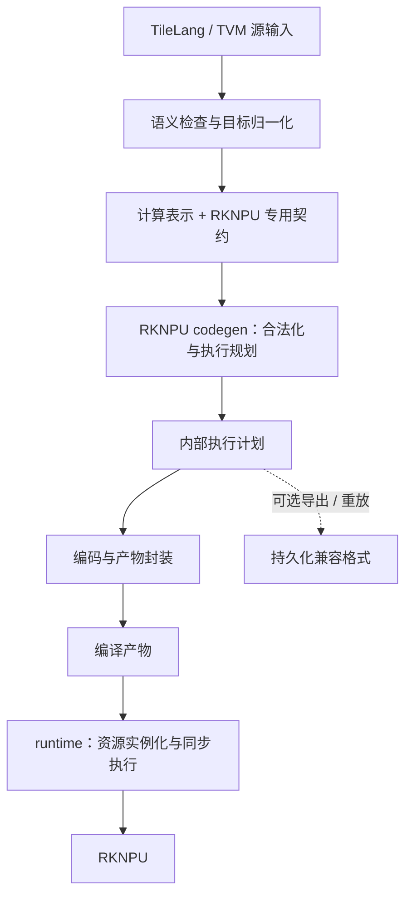

# TileLang → RKNPU 后端重构：架构与决策

日期：2026-10-27。状态：待实施的重构规范，不代表代码已经完成迁移。

本文规定目标、职责和决策边界；接口、迁移步骤、测试、证据与实施记录只在配套的 [refactor-specific.md](refactor-specific.md) 中维护。两份文件是本次重构仅有的设计与实施文档，不再另建方案、状态、实验报告或交接文档。

## 1. 背景与问题

后端已经建立真实 TileLang 输入到 RKNPU 执行的闭环，并完成模型及运行包络优化。本次不重做已完成的算子开发，也不以更换架构为由追溯增加原里程碑条件。

当前需要重新审视的是表示层与工程边界：

- 独立 RKIR 同时承担通用图结构和目标语义，其中前者可能与 TVM 重复。
- RKPlan 承担必要的执行规划，但调用者不应被迫以独立 JSON 文件为编译与执行的中介。
- 计算识别、合法化、规划、编码和资源实例化需要清晰分工，不能因为合并模块而混为一个有设备副作用的过程。

已有隔离实验支持“通用图容器可以替换”的可行性判断，尚不能证明生产路径删除 RKIR 后维护成本一定降低。迁移应以直接路径的正确性及工程收益为依据，不以减少一个名称或数据类数量作为目标。

## 2. 重构目标

本次将 RKNPU 后端收敛为两个主要边界：

1. **编译边界**：从计算语义生成完整、可验证的目标执行方案，并封装为编译产物。
2. **运行边界**：根据编译产物和调用者绑定创建资源，按已验证的方案同步执行。

通用计算表示优先复用 TVM；RKNPU 的数值、能力和执行约束仍由目标专用逻辑负责。执行计划的功能保留，但不要求它继续作为主要用户接口或独立公开格式存在。

## 3. 目标架构

这里的 codegen 是目标后端的编译职责集合。内部仍要区分规划与编码；只有 runtime 能绑定真实设备资源。组织在同一个包中不意味着这些阶段可以互相越权。

计算表示的最终载体由直接迁移证据决定：TVM 原生路径成立则逐步采用；否则保留薄 RKIR，不影响执行计划与 codegen 收敛主线的完成。

## 4. 三项架构决定

### 4.1 RKIR：不将独立容器视为必要条件

shape、dtype、图连接及基础分析优先复用上游。后端仍须表达和检查硬件精度、收窄点、支持条件与来源信息，但这些职责不必依附于另一套完整图模型。

不能通过在 TVM 属性中嵌入完整 RKIR 来宣称迁移成功，也不能为了消除 RKIR 而构建同等复杂的新图系统。生产默认切换须有直接输入路径和维护收益的证据。

### 4.2 执行计划：保留职责，弱化独立格式

布局、转换、任务、存储、依赖、提交及发布共同构成执行方案，不能在生成输出的过程中被隐式决定。内部执行计划应保持显式、可验证，并由 codegen 统一生成和编码。

正常使用应是“编译产物 → 实例化 → 执行”。持久化格式服务于导出、离线部署和重放，不成为内存内调用的必经路径。

### 4.3 runtime：保持资源与故障边界

runtime 消费已完成规划的产物，不临时猜测新的调度、融合或降级。资源所有权、同步、并发拒绝与故障隔离维持原契约。

重构不会使编译器产物成为可信输入的替代证明：运行时边界的独立校验继续存在。

## 5. 范围与兼容原则

本轮不增加算子、硬件配方、设备支持域、数值政策、多核或异步执行能力，也不承担整模型联合优化器的建设。更换表示不会自动扩大编译器能看到的图，不能据此宣称获得系统级规划能力。

现有离线编译、模型运行、诊断、重放和必要对照入口通过适配继续可用。兼容入口与新入口共用核心算法，避免维护两套后端。

已有正确性、数值和生命周期要求继续适用；历史文件中的阶段安排及强制表示形式不再约束本次重构。任务内的具体冲突、兼容范围与迁移条件由 specific 明确规定。

## 6. 迁移与决策方式

先收敛 codegen 和编译产物接口，再迁移计算表示，避免同时改变图语义、执行规划和设备接口。

执行智能体自主完成范围内的实现、验证、回退与局部接口调整。TVM 路径证据不足时可以保留薄 RKIR，并据实关闭该项探索；不为满足架构图强行删除现有能力。

涉及数值语义、硬件能力、资源生命周期或无法兼容的重要公共接口变化，才提交具体决策事项。不要逐步请求已经授权的常规实施确认。

## 7. 完成判断

本次完成的核心标准是：

- 正常编译到运行不依赖持久化往返，调用者围绕编译产物使用后端。
- 规划、编码与实例化边界清楚，核心算法只有一份。
- 原有数值、执行和故障行为得到保持，兼容范围可说明、可重放。
- RKIR 的采用或保留有直接实验和维护成本依据。
- 没有借重构引入未验收能力，也没有留下两套长期并行的生产实现。

具体交付、验收与记录方法全部见 [refactor-specific.md](refactor-specific.md)。
